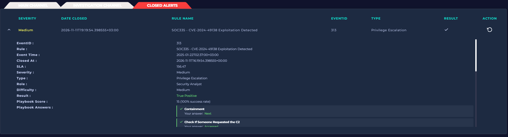
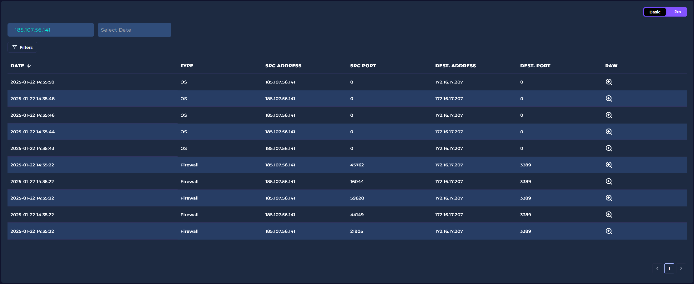
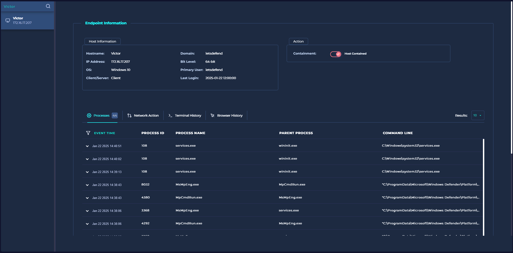
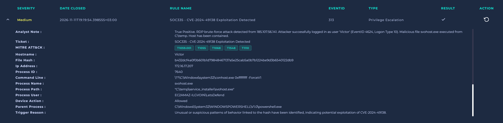

# LetsDefend Alert: SOC335 - CVE-2024-49138 Exploitation Detected

**Severity:** Medium
**Alert Type:** Privilege Escalation
**Date:** 2026-11-11

## 1. Summary
Обнаружен запуск подозрительного процесса `svohost.exe` на хосте `Victor` (IP 172.16.17.207). Процесс маскировался под системный `svchost.exe` и был запущен из временной папки `C:\temp`, что является признаком вредоносного ПО.

## 2. Investigation
* **Log Analysis:** В `Log Management` обнаружена серия подключений к порту 3389 (RDP) с внешнего IP `185.107.56.141`.
* **Initial Access:** В 14:35:48 зафиксирован успешный вход (EventID 4624, Logon Type 10) с указанного IP под учетной записью `Victor`.
* **Execution:** Сразу после входа был запущен вредоносный файл `svohost.exe` (Hash: `b432dcf4a0f0b601bd79848467137a5e25cab5a0b7b1224be9d3b6540122db9`).
* **Parent Process:** Вредоносный файл был запущен из `powershell.exe`, что указывает на выполнение скрипта.
* **C2 Communication:** В логах подтверждены сетевые соединения с C2-сервером `185.107.56.141`.

## 3. MITRE ATT&CK Mapping
* **Initial Access (T1133):** External Remote Services (RDP Brute-force).
* **Execution (T1059.001):** PowerShell.
* **Command and Control (T1071):** Application Layer Protocol.
* **Privilege Escalation (T1068):** Exploitation for Privilege Escalation.

## 4. Verdict
**True Positive.**
Подтверждена атака типа Brute-force с последующим успешным доступом по RDP и запуском вредоносного ПО.

## 5. Response Actions
* Хост `Victor` изолирован (Contained) через EDR.
* Инцидент эскалирован.

## 6. Evidence (Screenshots)

**1. Playbook Result:**

**2. Log Analysis (RDP Brute-force from C2 IP):**

**3. Host Containment (EDR):**

**4. Process Details & Parent Process:**

